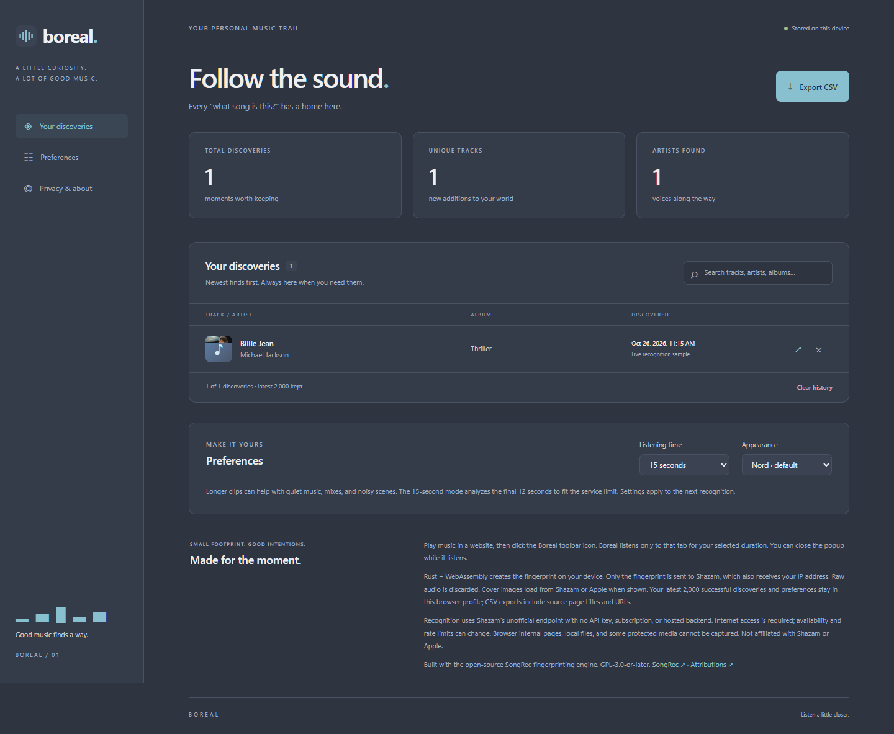

# Boreal · Music Recognizer

Recognize music playing in your current **Chrome or Edge** tab. Click the toolbar icon, listen for a moment, and find the track.



- **6, 10, or 15 seconds** of listening, with cancellation and progress.
- **Rust + WebAssembly** fingerprints audio locally. JavaScript handles browser APIs and the interface.
- **Recognition history** with search, track links, individual removal, and a confirmation before clearing.
- **Overview page** with discovery, unique-track, and artist counts.
- **CSV export** of the current search results, including timestamps and source pages. Unicode and spreadsheet formula protection included.
- **Nord** by default; a second **dark** theme. Preferences persist locally.
- No account, API key, paid backend, telemetry, remote scripts, or runtime JavaScript dependencies.

## Install in Chrome or Edge

The repository includes the compiled WebAssembly engine. **You do not need Rust, Node.js, or a build step to install it.**

1. Download this repository using **Code → Download ZIP**, then extract it.
2. Open `chrome://extensions` or `edge://extensions`.
3. Turn on **Developer mode**.
4. Click **Load unpacked** and choose the extracted **`extension` folder**, which contains `manifest.json`.
5. Pin Boreal in the browser's Extensions menu.
6. Play music in a website and click Boreal. The first recognition listens for 10 seconds. Use the popup or the overview preferences to choose another duration for the next attempt.

The popup starts recognition automatically. It keeps listening if the popup closes; reopen it to see the current attempt or result. Click **Listen again** for a new attempt while the popup is open. Opening the popup after a completed attempt starts another recognition. The overview is available from the Boreal logo, **View all**, or the extension's **Options** entry.

On the overview, **Export CSV exports the visible search results**. Clear the search first to export everything. The latest **2,000 successful recognitions** are retained; repeat discoveries are separate entries. Source URLs may contain private page information, so review a CSV before sharing it.

Browser internal pages, the Chrome Web Store, local files, and some protected media cannot be captured. Music must be playing in the tab where you click the icon. Requires Chrome/Chromium 116+ or a compatible current Edge release with `tabCapture` and `offscreen` support.

The 15-second option captures for the full 15 seconds and fingerprints the **final 12 seconds**. The unofficial service returned no matches for 15-second signatures in live checks, so the engine caps the analyzed window at SongRec's 12-second length. The 6- and 10-second modes analyze the entire clip.

## Free recognition, with an explicit limitation

Boreal uses the **unofficial Shazam recognition endpoint**, following the open-source [SongRec](https://github.com/marin-m/SongRec) protocol. It currently requires no API key or paid plan. There is no server to host and no subscription to configure.

**This is not an official, guaranteed free API.** Shazam can change, restrict, rate limit, or discontinue access. Boreal reports service errors and rate limits without automatic retries. Internet access is required. This project is not affiliated with Apple or Shazam.

## Privacy and permissions

- `activeTab`: read the current page's title/URL and gain access after a toolbar click.
- `tabCapture`: capture only audio from that tab for the selected duration. No microphone or video capture.
- `offscreen`: keep capture and local fingerprinting alive when the popup closes.
- `storage`: save preferences and history locally, plus temporary attempt state in session storage.
- `https://amp.shazam.com/*`: submit fingerprints for recognition.

Raw audio stays in memory and is discarded after fingerprinting; it is never uploaded or saved. Shazam receives the fingerprint, clip duration, timestamp, and your public IP address. No real or fabricated geolocation is submitted. Cover art loads directly from Shazam/Apple image hosts when displayed, revealing your IP to those hosts. Source titles/URLs are saved only in local history and CSV exports, not sent for recognition. No cloud history synchronization, telemetry, or content scripts.

## Build from source

Prerequisites: **Rust 1.88+**, Node.js 22+, and `wasm-bindgen-cli` **0.2.105** (must match the Rust dependency).

```sh
rustup target add wasm32-unknown-unknown
cargo install wasm-bindgen-cli --version 0.2.105 --locked
npm run check
npm run build
npm run package
```

Load `extension/` or extract `dist/boreal-1.0.0.zip` and load its contents. `npm run build` rebuilds the checked-in WASM and its generated JavaScript glue. No `npm install` is needed for the build or unit tests. Packaging uses PowerShell on Windows and `zip` on Linux/macOS.

## Tests

`npm run check` runs the Node tests, Rust tests, and Clippy. Rust tests check fingerprint serialization and bounds at every offered duration. Node tests check settings, provider parsing, safe CSV, history statistics, capture state, cancellation, stale jobs, and message permissions.

Optional browser integration check:

```sh
npm install --no-save --package-lock=false playwright
npx playwright install chromium
node tests/browser.smoke.mjs
```

This uses an isolated browser profile and a generated test tone. It invokes the actual toolbar action, captures real tab audio, runs the packaged WASM, and mocks only the recognition response. It checks history, search, CSV download, both themes, and clear confirmation. Screenshots go to ignored `test-results/`. It does not modify your normal browser profile.

Set `BOREAL_BROWSER_CHANNEL=msedge` to run the browser check against an installed Edge instead of bundled Chromium.

To additionally test the real provider, set `BOREAL_LIVE_PCM` to a path containing exactly 15 seconds of mono 16 kHz little-endian float32 audio before running the browser check. This optional check plays that sample in the test browser and exercises the entire 15-second capture → resample → fingerprint → Shazam → history flow, expecting a match. Test recordings are not included in the repository.

## Source layout

```text
extension/              Load-unpacked extension, including built WASM
  background.js         Capture coordination and serialized local storage
  offscreen.js          Web Audio capture, resampling, fingerprinting, request
  pcm-worklet.js        Exact-length mono PCM collection
  core.js               Shared data validation and CSV
  popup.* / overview.*  Interface and history
fingerprint/            Rust engine and adapted SongRec fingerprinting code
scripts/                Build and ZIP packaging
tests/                  Unit and optional browser integration checks
```

## License and credits

**GPL-3.0-or-later**. Boreal reuses and adapts SongRec's fingerprinting engine by Marin Moulinier and contributors. See [LICENSE](LICENSE) and [third-party notices](extension/THIRD_PARTY_NOTICES.md) for the pinned upstream revision and modifications. The Nord palette is inspired by [Nord](https://www.nordtheme.com/); all icons are original and fonts use your system's font stack.

Store publication and signing are not part of this repository. This is a developer-mode installation.
